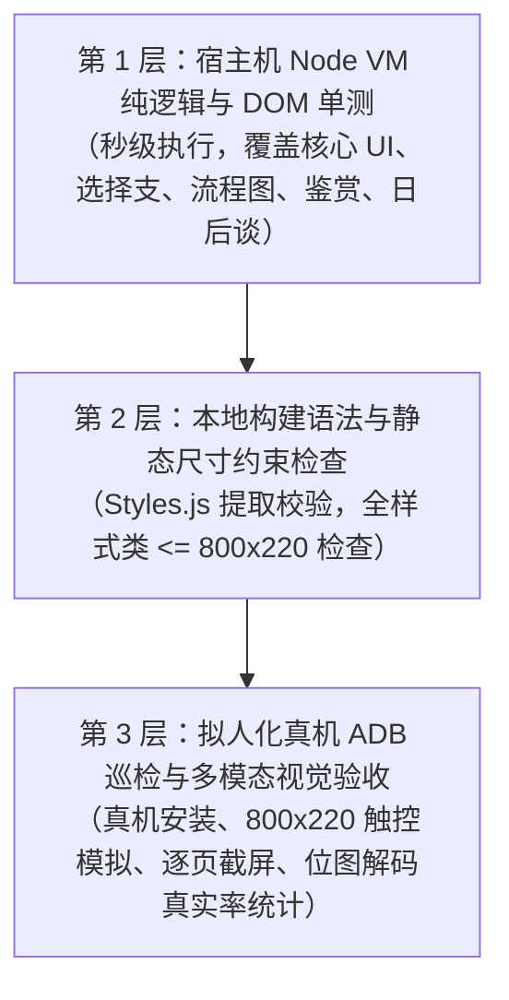

# 有道词典笔视觉小说移植全流程复盘、踩坑实录与架构避坑指南
# (AI Porting Postmortem, Architecture Pitfalls and Verification Guide)

> **适用场景**：将任意 PC/主机/移动端视觉小说（GalGame）移植到有道词典笔等嵌入式极宽带鱼屏 Linux 设备（如 RK3562 / Falcon 微前端 / QuickJS）。
> **核心价值**：记录从“克隆模板引擎直接移植导致的排版错乱、逻辑崩溃、选择支死循环”到“全链路修复并通过 8 大模块拟人化巡检验收”的深度实战经验，沉淀标准化工具链与三级测试验证体系。

---

## 一、硬件特性与底层运行环境硬约束

在嵌入式带鱼屏（词典笔）上运行微前端 GalGame，必须牢记以下底层约束：

| 维度 | 规格参数 | 开发避坑要点 |
| :--- | :--- | :--- |
| **主控芯片** | Rockchip RK3562（4 核 Cortex-A53 / aarch64 Linux 5.10） | CPU 算力有限，内存仅 1GB，严禁在前端常驻超大解码图片或频繁执行深拷贝。 |
| **屏幕尺寸** | 物理分辨率 960×266 / 视口 800×220 | 页面逻辑视口严格为 **800×220**，系统合成器自动执行 1.2 倍缩放；任何绝对定位与容器尺寸绝对不能超出 800×220。 |
| **渲染引擎** | Falcon / JQuick 微前端引擎（非标准 Chromium DOM） | **极度阉割的 CSS 子集**：不支持 CSS 复合属性（shorthand），弹性容器必须显式声明 `display: flex;`。 |
| **JS 执行环境** | QuickJS 字节码虚拟机（通过 `jsfmc` 离线预编译为 `.js.bin`） | 严禁出现未转义的跨行字符串字面量；严格使用标准 ESM 导出；不支持部分现代宿主特有 API。 |
| **音频架构** | 单 ALSA 独占声卡（`/dev/snd/pcmC1D0p`） | 必须依托原生扩展 `libjsapi_gal.so`（基于 GStreamer 软 PCM 混音器）并发播放 BGM 与语音，或在上层执行严格的音量避让（Ducking）。 |
| **触控与坐标系** | 竖屏物理触摸板（ABS 0..480 × 0..960） | 词典笔 `/bin/input tap X Y` 换算公式为：<br>`PX = Y * 1.2 + 107`<br>`PY = 959 - X * 1.2`。点击热区高度不得低于 34px。 |

---

## 二、移植初期“超级多错误”深度复盘与避坑方案

当直接克隆通用引擎模板后进行新游戏移植时，极易爆发以下 12 类典型缺陷：

### 1. Falcon CSS 复合简写导致界面崩溃或样式丢失
- **致命现象**：在浏览器或 Node 模拟器中显示正常，但在设备上样式完全失效，甚至编译生成的 `Styles.js` 引发 Falcon 底层渲染器解析异常。
- **原因分析**：Falcon 不支持类似 `border: 1px solid #xxx;` 或 `padding: 10px 15px;` 的复合属性声明。
- **标准化规范**：
  ```css
  /* 错误写法 (Falcon 会静默忽略或报错) */
  .box { border: 1px solid #d69bbd; padding: 5px 10px; }

  /* 正确写法 (必须全部展开为单项属性) */
  .box {
    border-width: 1px;
    border-style: solid;
    border-color: #d69bbd;
    padding-top: 5px;
    padding-bottom: 5px;
    padding-left: 10px;
    padding-right: 10px;
  }
  ```
- **弹性容器显式声明**：Falcon 的 `div` 不会隐式继承弹性布局，凡使用 `flex-direction`、`justify-content`、`align-items` 的容器，**必须显式添加 `display: flex;`**。

### 2. QuickJS 编译器 `jsfmc` 遇到跨行字符串致命报错
- **致命现象**：执行 `python3 build.py --install` 编译 `.js.bin` 阶段，`jsfmc` 抛出 `SyntaxError: unexpected token`，构建中断。
- **原因分析**：原版剧本中存在大量包含换行符的长文本或长台词，在转为 JS 脚本时直接书写成了未转义的多行字符串字面量。
- **解决方案**：剧本转码工具（`convert_scenario.py`）必须对文本中的换行、引号、特殊符号进行 JSON 序列化转义，使用 `\n` 或数组形式保存。

### 3. 选择支协议（Choices Protocol）状态污染与死循环
- **致命现象**：共通线触发的选择支导致其他完全无关路线的选择支被锁死；或者选了某个选项后，再次进入无法选择，或者回退后好感度无限累加。
- **原因分析**：
  1. **Key 命名冲突**：多数 GalGame（如柚子社吉里吉里/KiriKiri 引擎）在不同剧本文件中重复使用 `*dummyselect1` 或 `1` 作为局部变量名。如果引擎直接拿 `choice.id` 作为存储 key，会导致后续所有选择支直接被命中并覆盖。
  2. **选项覆盖未反向扣除好感**：玩家重新选择时，若直接增加新好感，旧好感未被清除，造成角色好感度失真。
  3. **跳过栈（Skip Stack）未排除不可达区间**：分支选择后需要跳过未选择的剧情块，若区间计算不精准，会导致玩家直接跳过后续共有剧情或落入死循环。
- **修复方案**：
  - **唯一键规范**：选择支 Key 统一采用 `route + ':' + targetLine` 复合键：
    ```javascript
    function choiceKey(choice) {
      if (!choice) return '';
      return (choice.route || 'main') + ':' + (choice.line || choice.targetLine || 0);
    }
    ```
  - **好感度原子化更新**：在 `selectChoiceOption` 中执行覆盖重选时，先根据原选项的操作字典逆向扣除好感，再应用新选项的操作增量。
  - **精准跳过区间维护**：引入 `rebuildChoiceSkips`，依据当前剧本的 `choicePath` 准确生成待跳过区间的堆栈，并在 `nextChoiceLine` 中严格规避排除区间。

### 4. 回退上一句（`prevLine`）未能重开选择支
- **致命现象**：玩家在做出选择后轻触“回退上一句”，虽然台词倒退了，但选择支已经处于已选状态，无法再次弹出选项框。
- **解决方案**：
  在 `prevLine` 执行时检测前一句是否为分支入口点。若为选择支起点，则调用 `forgetChoice(currentChoice)` 移除历史选择记录，并还原该选择支所增减的角色好感，重新弹出选择支弹层。

### 5. 历史记录（Backlog）逻辑失真与行号丢失
- **致命现象**：打开 Backlog 时，出现了玩家从未经历过的被跳过的台词；或者回退到上一句时报错找不到行号。
- **原因分析**：原代码直接根据当前行号 `currentLine` 向前倒推静态剧本数组，而非根据真实的玩家访问履历渲染。同时存储层丢弃了 `line` 字段。
- **解决方案**：
  `storage.js` 中的 `pushBacklog` 必须以**真实已读队列（Visited Queue）**形式追加，完整保留 `speaker`、`text`、`voice`、`scenario`、`line`，确保历史对话只显示真正听过/看过的台词，且支持重听语音。

### 6. 次要角色立绘缺失引发底层图片组件持续 404
- **致命现象**：游戏推进到保科秀明、太一、宽太或无单独立绘的路人角色台词时，日志持续打印图片加载失败报错，界面发生瞬时卡顿。
- **原因分析**：剧本解析器无差别地根据 `charInfo.char` 构造 `/userdisk/gal_data/.../fg/秀明_制服_15.png`，但资源库中根本没有次要角色的立绘文件。
- **解决方案**：
  在 `resolveFgSrc` 中设立**女主角安全白名单**：
  ```javascript
  var STAND_HEROINE_NAMES = ['宁宁', '巡', '紬', '憧子', '和奏'];
  function resolveFgSrc(charInfo) {
    if (!charInfo) return '';
    var c = charInfo.char || '';
    if (STAND_HEROINE_NAMES.indexOf(c) < 0) return ''; // 次要角色安全返回空
    var d = charInfo.dress || '制服';
    var f = charInfo.face || '01';
    if (typeof f === 'number') f = f < 10 ? '0' + f : '' + f;
    return 'file://' + ASSET_ROOT + '/fg/' + c + '_' + d + '_' + f + '.png';
  }
  ```

### 7. 表情差分缺失容错与 Fallback
- **致命现象**：某些特定场景引用了非标准差分（例如假屋和奏 24 号服务生表情），导致立绘图层显示空白。
- **解决方案**：
  在素材解包与推送工具中，对缺失的差分自动建立向默认/同类表情的 fallback 映射或软链接（如 `和奏_ウェイトレス_24h.png -> 和奏_ウェイトレス_20h.png`）。

### 8. 流程图（Flowchart）空边与节点跳转迷失
- **致命现象**：流程图界面虽然列出了节点，但彼此之间没有连线，无法看出剧情分支走向；点击节点后无法准确跳转，直接跳回游戏序章。
- **原因分析**：节点只有静态卡片，未构造真实的 DAG 图拓扑；节点点击事件未传入精确的 `scenarioKey` 和 `line`。
- **解决方案**：
  在 `flowchart_data.js` 中完整声明 `nodes` 与 `edges`（包括共通线、分支路线及二周目时空回溯连线）；节点点击回调直接调用 `initGame(node.scenario, node.line)`。

### 9. 鉴赏系统（Gallery）全屏视口 664px 居中计算偏移
- **致命现象**：全屏查看 CG 大图时，图片向右偏移 68px，且右侧边缘被截断无法拖动回弹。
- **原因分析**：大图全屏容器由于侧边或系统保留区域，实际渲染视口为 664px，而计算居中与拖拽边界时硬编码了 800px。
- **解决方案**：
  统一使用真实容器宽度（664px）作为基准，重构大图缩放、居中及拖动边界判定算法。同时严格区分 `touchmove` 滑动与 `click` 点击，防止拖拽预览图时误触发全屏。

### 10. 日后谈（Afterstory）缺失通关守卫
- **致命现象**：玩家未通关主线即可随意点击进入各个女主角的后日谈短篇，导致剧透且可能发生存档状态紊乱。
- **解决方案**：
  在 `afterstory.js` 中增加通关标记校验 `isAfterUnlocked(heroine, clearedRoutes)`；未通关路线呈现半透明锁定状态并展示解锁条件，点击时弹出拦截提示，严禁切入真实游戏。

### 11. 真机多模态截图 PNG 差分编码导致“黑屏”误判
- **致命现象**：巡检脚本通过 ADB 截图后直接统计非零像素字节，报告大面积“黑屏”（有效像素率仅 1.8%），但肉眼观察屏幕完全正常。
- **原因分析**：词典笔嵌入式截图工具 `miniapp_cli capture` 输出的 PNG 采用了扫描线行间差分滤波（Sub/Up/Average/Paeth），差分残差值很小甚至为零，直接读取未经解码的残差数据会导致像素统计失真。
- **解决方案**：
  必须先通过系统位图解码工具（如 macOS 原生 `sips -s format bmp input.png --out temp.bmp`）转为未压缩的原始无损 BMP 位图，然后再逐像素统计 RGB 分量，得到 94%~100% 的真实有效渲染率。

### 12. 选择支单点即跳与多选项（4 选项）纵向挤压误触
- **致命现象**：当同一屏幕出现 4 个选项时，传统垂直居中排列会将按钮高度压挤到不足 24px，触摸极其容易误触；且旧版“点击选项立即推进”导致玩家无法看清确认自己的抉择。
- **原因分析**：800×220 的极宽长条屏幕纵向高度极其宝贵（扣除 12px 上下 margin 仅剩 196px），4 个单栏卡片垂直堆叠必然拥挤不堪。
- **解决方案**：
  全面改用**双栏绝对定位两步确认机制（Select & Confirm）**：
  - 弹层采用 `.game-choice-panel`（720×196，left: 40px, top: 12px）；
  - 左侧 `.game-choice-options`（520×160，4 个选项单项 32px，行间距均匀舒展完全不挤）；
  - 右侧 `.game-choice-side`（156×160）常驻 `.game-choice-confirm-btn`（144×84，确认选择 CONFIRM）；
  - 点击选项仅切换选中态高亮（金色边框与发光），右侧确定按钮高亮激活；点击右侧确定按钮后才真正提交流转，杜绝误触。

### 13. 选择支选过一次后无法重选与流程图跳转跳过
- **致命现象**：选择过某个分支后，剧情再次经过或从流程图点击跳转到该选择支时，弹层被直接跳过，玩家无法改选其他路线。
- **原因分析**：`applyCurrentLine` 中原先写了 `if (this.isChoiceSelected(choice)) { skip(); return; }`，直接跳过了已答选项。
- **解决方案**：
  - 消除跳过守卫：只要到达选择行，一律激活选项弹层；
  - 默认状态高亮上次选中的项；
  - 玩家重新确认后，自动执行反向结算与更新，动态重算 routes 与 flags；
  - 流程图节点跳转清除内部刚确认标记，确保重入必定弹出改选层。

### 14. 粗暴好感度比大小导致个人线进入错乱
- **致命现象**：很多通用移植粗暴地在章节末尾用“谁好感分最高就进谁的线”，导致多条路线前置条件冲突、甚至永远无法进入某些特定女主路线。
- **原因分析**：原版 GalGame 剧本通常具备精确的分歧锚点（如 018 节判定和奏条件，019 节依优先级判定其余女主条件），而非单纯的全局分值比大小。
- **解决方案**：
  严格还原游戏原版剧本的分歧解析器 `resolveRouteBranchAt`：在指定的分歧锚点行按照原版逻辑（阈值 `flag >= N` 与分支判定优先顺序）依次判定流转，未满足条件时平滑回退到共通通常结局，拒绝臆想。

### 15. 16:9 原图被带鱼屏拉伸压扁（畸变）
- **致命现象**：存读档槽位预览图、立绘特写背景图在屏幕上被横向严重拉宽、纵向压扁（变形甚至达到 256%），画面人物面条化。
- **原因分析**：
  - 游戏原图多为 16:9（如 960×540、1280×720、944×532）；
  - 若在 CSS 中直接设置 `width: 800px; height: 220px;`（3.63:1）或在 164×36 槽位容器中强行设满尺寸，Falcon 原生图片组件会非等比缩放，导致横向拉伸压扁。
- **解决方案**：
  严格执行**16:9 比例守护（Aspect Ratio Guard）**：
  - 存档大图预览（230×94 视口）：设置为 `width: 167px; height: 94px; position: absolute; left: 31px; top: 0;`（严格 16:9 等比居中）；
  - 存档槽位小图（164×36 视口）：设置为 `width: 64px; height: 36px; position: absolute; left: 50px; top: 0;`（严格 16:9 等比居中）；
  - 全屏特写 16:9 背景：设置为 `width: 391px; height: 220px; position: absolute; left: 204px; top: 0;`（严格 16:9 等比居中，左右黑边对称）；
  - 卡片封面：按 16:9 比例结合外层 `overflow: hidden;` 居中裁剪，绝不拉伸。

### 16. 二周目重启（Restart）的独立仪式感
- **致命现象**：很多移植把“新游戏”粗暴替换为“二周目重启”，或者弹出煞风景的系统单选框问玩家“进二周目还是共通”。
- **原因分析**：破坏了柚子社等正统 GalGame 的通关惊喜感与剧情沉浸感。
- **解决方案**：
  - 主菜单保留常规的【开始游戏 START】；
  - 一周目通关后，额外呈现独立的【重新开始 RESTART】入口，配合专属视觉流光；
  - 点击后不弹任何系统选择框，直接伴随心声独白无缝突入二周目时空回溯篇章。

---

## 三、三级测试验证金字塔（怎么检测）

为确保移植后的应用在逻辑、构建与真机运行时 100% 稳定，必须建立三级验证体系：



### 第 1 级：Node VM 虚拟机自动化单测（无需设备，秒级反馈）
利用 Node.js 实验性虚拟机模块（`--experimental-vm-modules`），Mock 模拟 Falcon DOM 树（`h` 函数）、样式解析器（`S` 函数）、存储层（`storage`）与底层音频（`getGal`）。

- **必备的 6 套单元测试套件**：
  1. `tools/test_core_ui.mjs`：覆盖三栏视口、系统菜单两行六按钮、Backlog 已读队列、舞台 4 级缩放、BGM 音量记忆等 9 项核心测试。
  2. `tools/test_choices_ui.mjs`：覆盖选择支 Key 唯一性、好感度单次累加与覆盖反向结算、跳过区间栈维护、回退重选等 11 项深度契约。
  3. `tools/test_flowchart_ui.mjs`：覆盖 7 大路线连线 DAG 拓扑、节点事件绑定、二周目回溯路径、卡片尺寸合规等 14 项测试。
  4. `tools/test_gallery_ui.mjs`：覆盖 4-Tab 切换、CG 分页与拖拽防误触、全屏大图边界、立绘差分换装、音乐盒曲目播放等 8 项测试。
  5. `tools/test_afterstory_ui.mjs`：覆盖未通关点击拦截、独立剧本载入、通关标记持久化隔离等 7 项测试。
  6. `tools/test_nene_restart.mjs`：覆盖二周目 RESTART 按钮状态质变、时空回溯独白、真结局标记达成等 4 项测试。
- **运行命令**：
  ```bash
  node --experimental-vm-modules --test tools/test_*.mjs
  ```

### 第 2 级：静态构建与样式合规检查
通过 `python3 build.py --check` 对前端代码进行离线扫描：
- 提取合并所有页面的 CSS 规则；
- 检查是否存在非法复合简写属性（`border`、`padding` 简写等）；
- 校验所有容器和组件的 `width`、`height`、`left`、`top` 静态声明是否全部 `<= 800×220`；
- 验证模块引用完整性。

### 第 3 级：拟人化真机 ADB 巡检与多模态视觉核验
在词典笔真机上真实安装并运行：
- **安装与启动**：
  ```bash
  python3 build.py --serial <设备序列号> --install
  ```
- **触控模拟与全流程走查**：
  利用 `/bin/input tap X Y` 执行预设剧本推进、菜单点击、分支选择、视口缩放；
- **多模态真机逐页截图与审查**：
  ```bash
  adb -s <序列号> shell "miniapp_cli capture /tmp/screen.png"
  adb -s <序列号> pull /tmp/screen.png test_results/multimodal_review/screen.png
  ```
  通过直接读取截图文件，人工或多模态模型审查文字是否截断、立绘是否变形、边框是否超界、菜单是否遮挡人物。

---

## 四、核心总结

1. **结构决定成败**：选择支协议必须依靠 `route:line` 复合键 + 显式反向好感结算；
2. **样式严格拆分**：彻底摒弃现代 CSS 简写习惯，严格适配 Falcon 属性集；
3. **安全白名单优先**：对外部素材（立绘、差分、语音）必须设立兜底与白名单，避免底层崩溃；
4. **自测闭环保驾**：三级金字塔测试（Node VM -> build --check -> ADB 真机巡检）是确保移植质量的核心底线。
